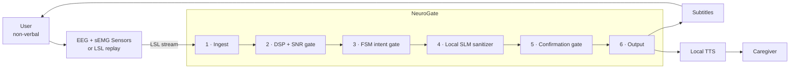

# NeuroGate

**Intent-gated edge middleware for assistive, hands-free communication.**

NeuroGate sits between non-invasive biosignal sensors (EEG + sEMG) and assistive
output devices (subtitles, local text-to-speech). It filters cognitive and
physiological noise out of a continuous thought stream so that only *deliberate*
communication intent ever reaches a display or a speaker.

> **Domain B — Education & Human Capability (Accessibility)**
> Team **Sabradox** · Sabaragamuwa University of Sri Lanka

---

## The problem in one paragraph

Non-invasive silent-speech interfaces capture an uninterrupted stream of
consciousness, not clean sentences. Deliberate intent arrives entangled with
fatigue, pain, stray inner monologue, and muscle artifacts. Existing decoders
treat every detected internal vocalization equally, so they produce high
false-activation rates and accidentally speak things the user never meant to say.
A non-verbal user's dignity is not a place to ship a single-pass pipeline.

## What NeuroGate does about it

| Tier | What happens | Determinism |
|------|--------------|-------------|
| 1. Ingest | LSL biosignal stream → bounded ring buffer | deterministic |
| 2. DSP | bandpass, artifact rejection, RMS envelope, band power, SNR gate | deterministic |
| 3. Intent | FSM gate decides *whether* to speak; local SLM decides *what* to keep | FSM deterministic, SLM probabilistic |
| 4. Output | human confirmation gate → subtitles + local TTS | deterministic |

Nothing is spoken without a resolved confirmation decision. Nothing is persisted.
Nothing leaves the device.

## Architecture at a glance



Deeper views:

- [System architecture](docs/01-system-architecture.md)
- [Agent decision loop & FSM](docs/02-agent-decision-loop.md)
- [Signal processing](docs/03-signal-processing.md)
- [Data contracts](docs/07-data-contracts.md)
- [Multilingual support](docs/08-multilingual-support.md)

## Why an agent and not a chatbot

A chatbot waits for a prompt. This system never receives one. It reads a
continuous 1000 Hz sensor stream with no turn boundaries, must decide on its own
when an attempt becomes an utterance, orchestrates several local tools, and feeds
the result of each action back into the next decision. That is a perception →
decision → action → loop cycle, not a request/response exchange.

## Multilingual by design

Sinhala, Tamil and English are supported end to end:

- detection: Unicode script ranges first, SLM hint second;
- filtering: per-language noise lexicons (fatigue, pain, filler);
- rendering: UTF-8 subtitles with script-aware fonts and line breaking;
- speech: `si-LK`, `ta-LK`, `en-US` voices, with a visible subtitle-only fallback
  and **never** a silent language swap.

See [08 — Multilingual support](docs/08-multilingual-support.md).

## Safety posture

| Guarantee | Mechanism |
|-----------|-----------|
| No unintended audio | 1.5 s human confirmation window, cancellable |
| No guessing | calibrated SNR floor + SLM confidence floor (0.75) |
| No silent failure | all fallbacks render a visible banner |
| No irreversible actions | the agent has no actuation tools |
| No data retention | RAM-only buffers, purged per intent cycle |
| No cloud dependency | local quantized model over loopback |

Not a medical device. See [05 — Safety, ethics & responsible AI](docs/05-safety-and-ethics.md).

## No hardware? That is a supported mode

The sensor layer is the Lab Streaming Layer contract, so a replayed open dataset
and a physical headband are interchangeable at the inlet. The simulator publishes
real EEG statistics from PhysioNet data plus a scripted synthetic sEMG envelope;
the rest of the stack is unchanged. Demo mode also prints the ground-truth intent
next to the delivered output so a reviewer can verify the filter rather than
trust it.

## Repository layout

```text
neuro-gate/
├── README.md
├── docs/                          # architecture, contracts, safety, roadmap
│   ├── 00-index.md
│   ├── 01-system-architecture.md
│   ├── 02-agent-decision-loop.md
│   ├── 03-signal-processing.md
│   ├── 04-technical-stack.md
│   ├── 05-safety-and-ethics.md
│   ├── 06-user-scenarios.md
│   ├── 07-data-contracts.md
│   ├── 08-multilingual-support.md
│   ├── 09-roadmap-and-risks.md
│   ├── adr/                       # architecture decision records
│   └── diagrams/                  # standalone Mermaid sources (.mmd)
└── specs/
    └── 001-neuro-gate-assistive-middleware/
        ├── spec.md
        └── checklists/requirements.md
```

Implementation (`src/`, `tests/`) is planned and not yet present. This
repository currently holds the specification that implementation will follow.

## Status

| Phase | State |
|-------|-------|
| Specification & architecture | complete |
| Prototype (DSP, FSM, SLM, output) | planned |
| Benchmark suite | planned |
| Research paper | planned |

## Roadmap

Milestones and the risk register live in
[09 — Roadmap & risk register](docs/09-roadmap-and-risks.md).

## Team

| Role | Responsibility |
|------|----------------|
| D.M.M. C. Udayanga | architecture, SLM middleware, evaluation |
| D.M.C.L. Karunarathna | signal processing & LSL simulation |
| S.M.A.B. Samarakoon | UI, TTS output, demo production |

## Licence

To be decided before public release. All third-party datasets, models, and assets
used by the implementation must be acknowledged in this file and in the relevant
module.

## Disclaimer

NeuroGate is an assistive communication interface. It is **not** a medical
device, not a diagnostic tool, and not a clinical life-support system. Outputs
are informational and must not be used as the sole basis for medical, legal, or
safety decisions.
