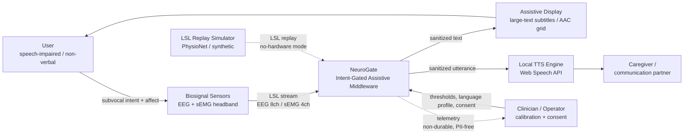
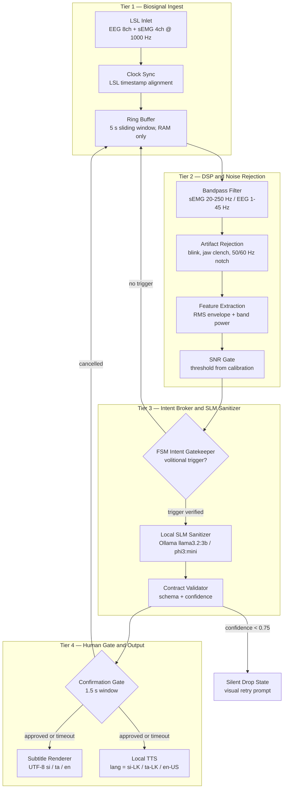

# 01 — System Architecture

## 1. What NeuroGate is

NeuroGate is a **software-only, hardware-agnostic middleware layer**. It does not
manufacture sensors and it does not decode raw neural activity into text on its
own. It occupies the missing seam between two things that already exist:

1. non-invasive sensors that produce continuous biosignal streams, and
2. output surfaces that can render text or synthesize speech.

The value it adds is **gating**: deciding *when* a detected internal signal is a
deliberate communication attempt, and *which* parts of a continuous thought
stream are noise that must never be spoken aloud.

> **One-line definition.** NeuroGate is a deterministic intent firewall that
> converts an always-on biosignal stream into a small number of confirmed,
> privacy-safe utterances.

## 2. System context

Source: [`diagrams/01-system-context.mmd`](diagrams/01-system-context.mmd)

### Boundary notes

- **In scope**: ingest, filtering, intent gating, sanitization, confirmation,
  rendering, and TTS dispatch.
- **Out of scope**: sensor firmware, electrode design, neural decoding model
  training, medical diagnosis, and any actuation with irreversible physical
  effects.
- The **simulator is a first-class citizen**, not a test stub. LSL is the
  contract, so a replayed PhysioNet stream and a real headband are
  interchangeable at the inlet.

## 3. Four-tier runtime pipeline

Source: [`diagrams/02-layered-pipeline.mmd`](diagrams/02-layered-pipeline.mmd)

### Why four tiers and not one model

A single end-to-end model would have to learn, simultaneously, signal quality,
volition detection, semantic intent, and language normalization — from a small,
noisy, non-representative dataset. Splitting the problem means:

| Tier | Nature | Failure mode if merged away |
|------|--------|-----------------------------|
| 1–2 | Deterministic DSP | A model would silently hallucinate through bad signal instead of refusing. |
| 3 | Deterministic FSM + probabilistic SLM | No hard boundary between "thinking" and "speaking". |
| 4 | Human gate | No last line of defence before audio leaves the device. |

The deterministic tiers are auditable. Only Tier 3's semantic step is
probabilistic, and it is wrapped by a schema validator and a confidence floor.

## 4. Data flow summary

| Step | Input | Output | Determinism |
|------|-------|--------|-------------|
| Ingest | LSL frames | timestamped ring buffer | deterministic |
| Preprocess | raw samples | feature frame + SNR | deterministic |
| Gate | feature frame | `TriggerEvent` or discard | deterministic |
| Buffer | trigger + window | `ThoughtBuffer` | deterministic |
| Sanitize | thought buffer | `SanitizedIntent` | probabilistic |
| Confirm | sanitized intent | `ConfirmationDecision` | human |
| Emit | decision | `OutputEvent` (display / TTS) | deterministic |

Full model definitions: [07 — Data contracts](07-data-contracts.md).

## 5. Human intervention points

The competition rules forbid irreversible actions without human confirmation.
NeuroGate has three explicit interventions, all of which are *blocks*, never
advisories:

1. **Calibration gate** — an operator must lock a baseline before the FSM leaves
   `CALIBRATING`. No baseline, no speech.
2. **Utterance confirmation gate** — 1.5 s window before any audio is played.
3. **Fault reset gate** — `FAULT` is only escapable by an operator action.

## 6. Deployment shape

Single process (or two cooperating local processes) on a consumer laptop or NPU
device. No server. See [04 — Technical stack](04-technical-stack.md) and
[`diagrams/08-edge-deployment.mmd`](diagrams/08-edge-deployment.mmd).

## 7. Explicit non-goals

- Not a medical device and not a diagnostic instrument.
- Not a replacement for a certified AAC (augmentative and alternative
  communication) solution in clinical use.
- Not a general-purpose "mind reader". It gates and sanitizes; it does not claim
  to infer unspoken meaning.
- Not cloud-hosted. There is no server-side component by design.
