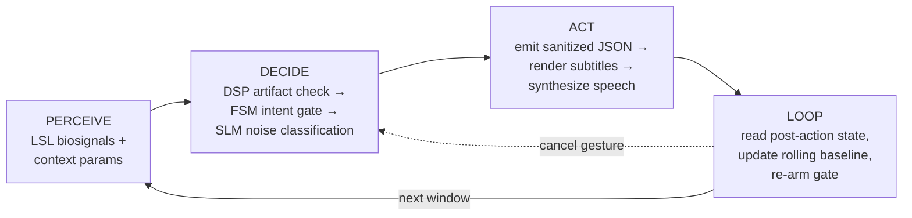
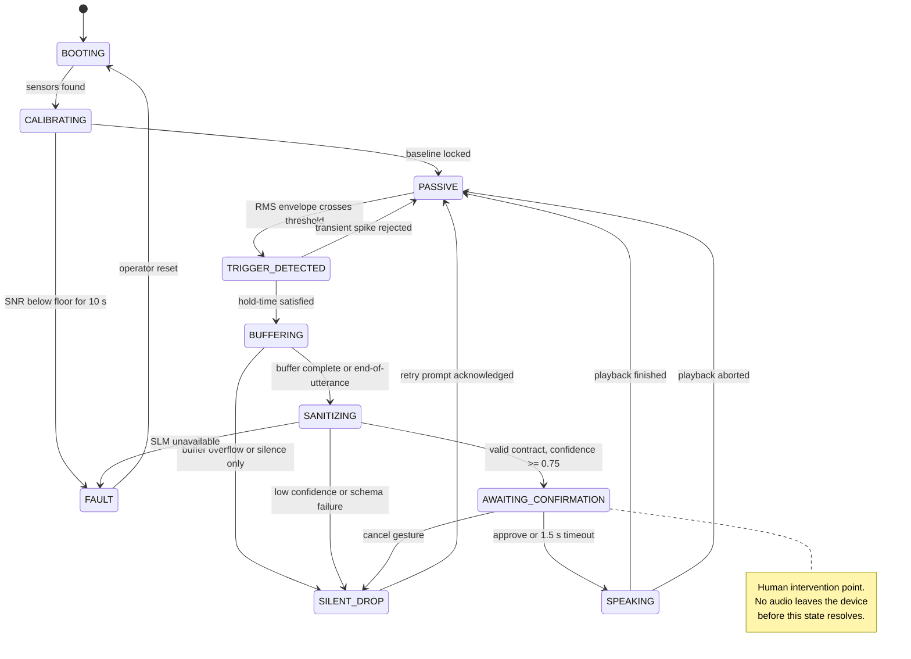

# 02 — Agent Decision Loop

NeuroGate is an agent in the competition's four-part sense: it perceives a
non-prompt input stream, decides through a reasoning component, acts through
real tools, and loops on the result of its own actions. This document makes each
part concrete and shows where the deterministic FSM bounds the probabilistic SLM.

## 1. Four-part agent test

Source: [`diagrams/04-agent-decision-loop.mmd`](diagrams/04-agent-decision-loop.mmd)

### Perceive

Inputs beyond a single user prompt:

| Input | Source | Cadence | Used for |
|-------|--------|---------|----------|
| sEMG envelope | LSL, 4 channels | 1000 Hz → 20 Hz features | volitional articulation proxy |
| EEG band power | LSL, 8 channels | 1 s Welch epochs | cognitive load / affect context |
| SNR estimate | DSP | per frame | refuse rather than guess |
| Language profile | operator config | static | TTS locale + SLM prompt |
| Calibration baseline | operator session | once per session | adaptive thresholds |
| Prior output state | output layer | per utterance | loop closure, cancel handling |

The agent is **not** waiting for a text prompt. It is continuously reading a
sensor stream, which is precisely why intent gating is mandatory.

### Decide

The reasoning core is a three-stage cascade, ordered from cheapest and most
deterministic to most expensive and most probabilistic:

1. **DSP artifact check** — reject frames whose SNR or artifact flags disqualify
   them. No model is invoked. Most frames end here, which is the main latency and
   cost win.
2. **FSM intent gate** — a deterministic state machine asks a single question:
   *did the sEMG envelope cross the calibrated threshold and hold long enough to
   constitute a volitional attempt?* A transient jaw clench is rejected.
3. **SLM noise classification** — only for frames that passed both, the local
   small language model separates deliberate content from affective noise and
   returns a strict JSON contract with a confidence score.

Numbered decision outputs are boolean-ish and testable: `discard`, `reject`,
`sanitize`, `drop_silently`, or `dispatch`.

### Act

Real tools the agent calls, none of which are irreversible:

| Tool | Effect | Reversible |
|------|--------|------------|
| Contract validator | rejects malformed SLM output | n/a |
| Subtitle renderer | draws text to local display | yes |
| TTS bridge | plays local audio | yes, abortable within window |
| Fault logger | emits PII-free structured event | yes |

The agent deliberately has **no** tool that can actuate the physical world
(lock a door, send a message, place an order). This is a design constraint, not
an oversight.

### Loop

After an utterance, the agent reads back:

- whether playback completed or was aborted,
- whether the user cancelled in the confirmation window,
- the observed SNR of the window just processed.

That feedback updates a **rolling baseline** for the gate threshold, so a user
who is consistently over-triggering gets a slightly higher threshold on the next
cycle. The loop then re-arms the gate. State never survives the session
(see [ADR 0002](adr/0002-ephemeral-state.md)).

## 2. Finite state machine

Source: [`diagrams/03-fsm-state-machine.mmd`](diagrams/03-fsm-state-machine.mmd)

### State contract

| State | Invariant | Timeout | Recovery |
|-------|-----------|---------|----------|
| `BOOTING` | no output permitted | 10 s | operator |
| `CALIBRATING` | no output permitted | 60 s | operator re-run |
| `PASSIVE` | buffers rotate, nothing retained | n/a | n/a |
| `TRIGGER_DETECTED` | hold window open | 500 ms | back to `PASSIVE` |
| `BUFFERING` | at most 5 s retained | 5 s | `SILENT_DROP` |
| `SANITIZING` | single SLM call in flight | 4 s | `FAULT` on timeout |
| `AWAITING_CONFIRMATION` | output staged, not emitted | 1.5 s | expiry approves; explicit cancel suppresses |
| `SPEAKING` | audio abortable | utterance length | `PASSIVE` |
| `SILENT_DROP` | nothing emitted, no retry spam | 2 s | `PASSIVE` |
| `FAULT` | all output blocked | n/a | operator only |

### Why an FSM instead of letting the model decide

An LLM asked "should I speak?" is itself a source of false activation — it can
hallucinate a trigger. The FSM is small, deterministic, and provable: for every
state and every input class there is exactly one next state. The SLM never has
the authority to move the machine into `SPEAKING`; only the confirmation gate
can.

## 3. Latency budget

Targets for the local prototype, measured per intent cycle:

| Stage | p50 target | p95 target | Notes |
|-------|-----------|-----------|-------|
| DSP feature extraction | 10 ms | 25 ms | NumPy/SciPy on CPU |
| FSM transition | < 1 ms | 2 ms | pure logic |
| SLM sanitization | 900 ms | 2.5 s | 3B quantized, warm |
| Contract validation | 2 ms | 5 ms | Pydantic v2 |
| Confirmation window | 1.5 s | 1.5 s | fixed by design |
| **End of speech → audio start** | **~2.5 s** | **~4.5 s** | dominated by SLM |

The confirmation window overlaps with SLM output being staged, so it is not
additive in practice.

## 4. What the agent must never do

- Emit audio without a resolved `ConfirmationDecision`.
- Retry the SLM more than once per buffer.
- Persist a thought buffer beyond its cycle.
- Invoke any tool that changes physical world state.
- Continue operating in `FAULT`.
