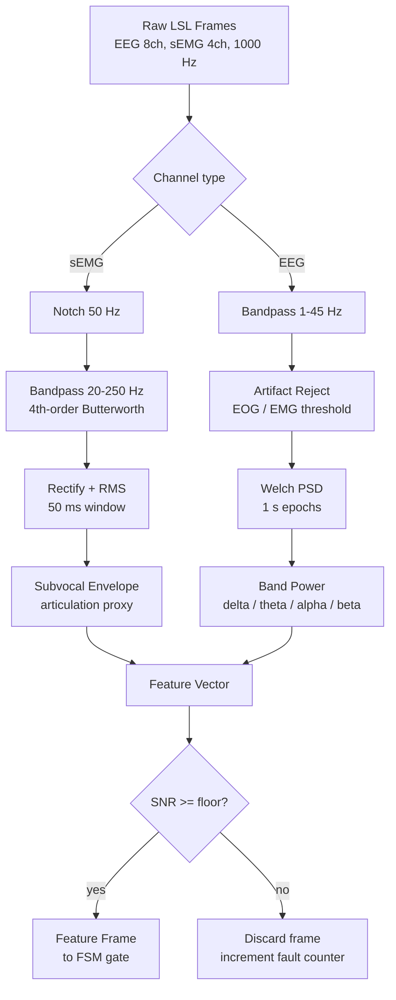

# 03 — Signal Processing

This tier exists to make one guarantee: **the semantic layer only ever sees
frames that are physically plausible.** Everything upstream of the SLM is
deterministic and unit-testable.

## 1. Pipeline



Source: [`diagrams/05-dsp-pipeline.mmd`](diagrams/05-dsp-pipeline.mmd)

## 2. Channel roles

| Modality | Channels | Primary use | Why |
|----------|----------|-------------|-----|
| sEMG | jaw / throat / submental | volitional articulation envelope | sEMG has far better temporal resolution for *when* a user attempts to speak than EEG does |
| EEG | frontal + temporal montage | affect / cognitive-load context | distinguishes fatigue and stress states that colour the thought stream |
| Both | — | joint SNR estimate | refuse to guess when either modality is degraded |

EEG is deliberately **not** used as the primary intent channel. Non-invasive EEG
decoding of continuous speech is not reliable enough to be the sole trigger, and
building a system that pretends otherwise would be dishonest. sEMG provides the
trigger; EEG provides the context.

## 3. Filter parameters

| Stage | Parameter | Value | Rationale |
|-------|-----------|-------|-----------|
| Mains notch | centre | 50 Hz (LK grid) | removes powerline interference |
| sEMG bandpass | passband | 20–250 Hz | captures muscle activation, rejects motion drift |
| EEG bandpass | passband | 1–45 Hz | retains delta→gamma-relevant bands, rejects DC drift |
| sEMG envelope | RMS window | 50 ms | fast enough for articulation onset |
| EEG PSD | Welch epoch | 1 s, 50 % overlap | stable band-power estimate |
| Trigger hold | duration | 150–500 ms (calibrated) | rejects single-sample spikes |

All parameters are configuration, never hard-coded, and all are logged with each
feature frame so a session can be reproduced.

## 4. Calibration

Calibration is a **blocking gate**, not a suggestion.

1. Operator fits the headband and confirms informed consent.
2. 20 s of rest → establishes noise floor per channel.
3. 10 guided subvocal attempts ("silently say your name") → establishes envelope
   amplitude for a volitional attempt.
4. Threshold = `noise_floor_p95 + k × (attempt_median − noise_floor_p95)`, with
   `k` defaulting to `0.6` and adjustable per user.
5. Baseline is frozen into the session; the FSM leaves `CALIBRATING` only on
   success.

If step 2 or 3 fails to produce a usable separation, calibration fails and the
system stays silent. This is intentional: a permissive fallback here is how
false activations happen in the field.

## 5. SNR gate

Frames below the calibrated SNR floor are discarded before the FSM, and a fault
counter increments. If the counter exceeds a threshold within a rolling window,
the FSM moves to `FAULT` and stops all output.

The gate is the reason the system can claim "refuses rather than guesses". It is
also the cheapest safety mechanism in the whole pipeline.

## 6. Feature frame

```text
FeatureFrame
├── window_id            monotonic id
├── semg_rms             0..1 normalized envelope peak
├── semg_onset_ms        time since envelope crossed floor
├── band_power           {delta, theta, alpha, beta} normalized
├── snr_db               estimated per-modality SNR
├── artifact_flagged     bool
└── lsl_timestamp        original sensor clock
```

No raw waveform leaves this tier except inside the bounded ring buffer used to
reconstruct a text buffer upstream. See [07 — Data contracts](07-data-contracts.md).

## 7. Simulation mode

When no headband is present, the same inlet consumes a replayed LSL stream:

- **PhysioNet EEG Motor Imagery** for realistic EEG statistics, and
- a scripted synthetic sEMG envelope generator for controlled trigger tests,
- with a text side-channel that supplies the "decoded" thought stream.

The DSP code path is byte-identical between simulation and hardware. Only the
outlet differs. This is what makes a hardware-free demo honest rather than
staged.
