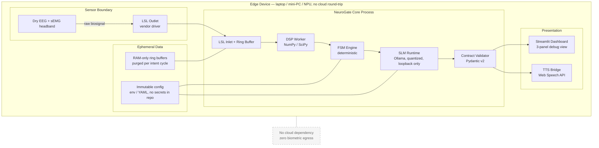

# 04 — Technical Stack, Cost & Deployment

## 1. Stack

| Layer | Technology | Role | Notes |
|-------|-----------|------|-------|
| Transport | **LSL (Lab Streaming Layer), `pylsl`** | biosignal transport contract | vendor-neutral; hardware and simulator are interchangeable |
| Numerics | **NumPy, SciPy** | filtering, RMS, Welch PSD | signal path is deterministic and unit-testable |
| Contracts | **Pydantic v2** | validation at every boundary | mandated by the project constitution |
| Orchestration | **Deterministic FSM engine** (small custom engine; LangGraph optional) | intent gating | FSM owns authority, not the model |
| Semantic filter | **Ollama** + `llama3.2:3b` / `phi3:mini` (quantized) | noise classification, multilingual sanitization | loopback-only HTTP, structured JSON output |
| UI | **Streamlit** | 3-panel operator/demo dashboard | debug view, not the product surface |
| Speech | **Web Speech API** (`speechSynthesis`) | local TTS + locale selection | OS voices; graceful subtitle-only fallback |
| Testing | **pytest** + property-based tests for the FSM | verification | deterministic, no network in tests |

### Why local models, not cloud APIs

The utterances being filtered are the user's private thoughts. Sending them to a
cloud endpoint would be a privacy failure regardless of the quality gain. It also
would create a hard dependency on connectivity for a device that a non-verbal
user may rely on to communicate. See [ADR 0001](adr/0001-edge-only-inference.md).

## 2. Edge deployment topology



Source: [`diagrams/08-edge-deployment.mmd`](diagrams/08-edge-deployment.mmd)

### Hardware profile (reference)

| Resource | Prototype target | Notes |
|----------|-----------------|-------|
| CPU | 4 cores, x86-64 | DSP is cheap; SLM dominates |
| RAM | 8 GB minimum, 16 GB comfortable | 3B quantized model plus buffers |
| NPU/GPU | optional | reduces SLM latency, not required |
| Disk | ~3 GB | model weights |
| Network | none required at runtime | update path only |

## 3. Cost model

The cost objection for this project is not compute spend; it is **per-user
deployment cost**, because each user needs a local model.

| Item | Prototype cost | Per-user cost | Notes |
|------|---------------|---------------|-------|
| Cloud inference | **LKR 0** | **LKR 0** | no cloud calls by design |
| Model weights | LKR 0 | LKR 0 | open-weight licences |
| Software | LKR 0 | LKR 0 | open source |
| Hardware | existing laptop | sensor + edge device | external, out of scope |
| Operator time | calibration per session | ~5 minutes | the real operational cost |

The competition's token budget is trivially satisfied: the architecture spends
**zero** cloud tokens, because there is no cloud component.

## 4. Scalability path

| Horizon | Change | Why it stays compatible |
|---------|--------|-------------------------|
| Prototype | one user, one device, replayed LSL | baseline |
| Pilot | real headband, small cohort | LSL contract unchanged |
| Product | multi-user operator console | one FSM instance per session, no shared state |
| Research | benchmark suite across datasets | DSP + FSM are dataset-agnostic |

There is deliberately **no** shared server to scale. Scaling means more edge
devices, not bigger servers — which is the correct shape for a privacy-sensitive
assistive device.

## 5. Repository layout (planned)

```text
neuro-gate/
├── README.md
├── docs/                     # this documentation set + diagram sources
├── specs/                    # specification artifacts
├── src/neurogate/            # planned package
│   ├── ingest/               # LSL inlets, ring buffers, simulator
│   ├── dsp/                  # filters, features, SNR
│   ├── fsm/                  # state machine + transitions
│   ├── sanitize/             # SLM client, prompts, contract validation
│   ├── output/               # subtitle renderer, TTS bridge
│   └── contracts/            # Pydantic models
├── tests/
└── config/
```

No implementation code exists in this repository yet. This document set is the
specification that implementation will be built against.
