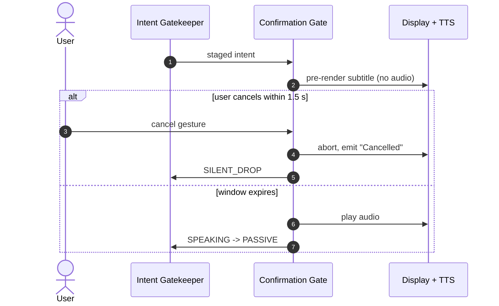
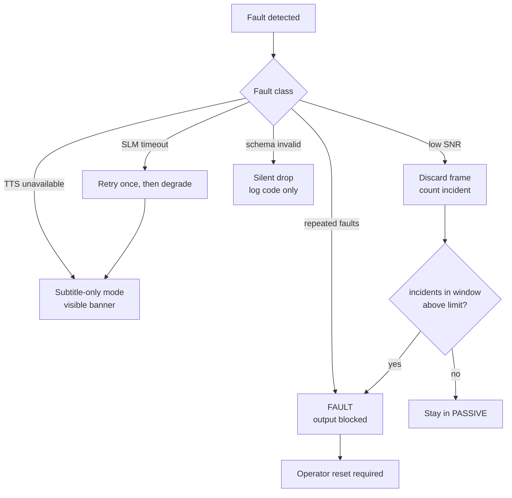

# 05 — Safety, Ethics & Responsible AI

Assistive technology for non-verbal users carries a specific ethical weight: if
the system speaks something the user did not intend, the harm is not a bad
search result. It is a breach of dignity, and potentially a breach of privacy in
front of caregivers, clinicians, or strangers.

## 1. Human oversight

Three mandatory gates. All are **blocking**, none are advisory.

| Gate | Where | What it prevents | Who can pass it |
|------|-------|------------------|-----------------|
| Calibration gate | `CALIBRATING → PASSIVE` | speaking on an unvalidated signal chain | operator |
| Confirmation gate | `AWAITING_CONFIRMATION → SPEAKING` | unintended audio | user cancels; expiry counts as approval |
| Fault reset gate | `FAULT → BOOTING` | resuming after a degraded state | operator |

Source: [`diagrams/07-sequence-cancel-and-failure.mmd`](diagrams/07-sequence-cancel-and-failure.mmd)

### Why 1.5 s

Long enough to register and cancel a mistake, short enough not to make
conversation feel broken. It is a tunable parameter with a documented default,
not a magic constant.

### Irreversible actions

NeuroGate has **no** irreversible tools. It cannot send messages, unlock doors,
spend money, or call emergency services. If a future version adds such a tool, it
requires explicit per-action confirmation and a constitution-level review, not a
config flag.

## 2. Failure handling

Rules, stated plainly:

1. **Never guess.** Below the confidence floor, the system says nothing and shows
   *"Intent unclear — please repeat."*
2. **Never loop silently.** At most one SLM retry per buffer.
3. **Never fail open.** Any unhandled condition resolves to no audio.
4. **Degrade visibly.** Fallbacks are announced on screen, never silently applied.

## 3. Data ethics

| Data | Lifetime | Storage | Egress |
|------|----------|---------|--------|
| Raw biosignal samples | rolling 5 s window | RAM only | none |
| Feature frames | per intent cycle | RAM only | none |
| Thought buffers | per intent cycle | RAM only | none |
| Sanitized intent | per intent cycle | RAM only | none |
| Fault events | session | memory + local log, **no payload text** | none |
| Config / calibration params | session | memory | none |

Commitments:

- **No retention.** Nothing crosses a session boundary.
- **No biometric egress.** The SLM runtime is bound to loopback.
- **Consent before capture.** Calibration cannot start without an operator-entered
  consent record.
- **Minimization.** Fault logs carry codes and timing, never decoded text.
- **Anonymity by architecture.** There is no account system and no identifier
  attached to a session.

If a future feature needs any of that to change, it is an amendment, not a
backlog item.

## 4. Disclaimers

> **Assistive technology disclaimer.** NeuroGate is an assistive communication
> interface intended to support convenience and accessibility. It is not a
> medical device, not a diagnostic tool, and not a clinical life-support system.
> Outputs must not be used as the sole basis for medical, legal, or safety
> decisions.

> **Health information disclaimer.** Any health-adjacent wording the system
> renders is user-authored communication, not professional advice. NeuroGate
> does not interpret, diagnose, or recommend treatment.

> **Dignity disclaimer.** Because the system filters the user's inner monologue,
> it must always be transparent about what it removed. The debug view shows
> rejected fragments locally so the user can audit the filter; that view is never
> transmitted.

## 5. Known harms and mitigations

| Harm | Mechanism | Mitigation | Residual risk |
|------|-----------|------------|---------------|
| Speaking an unintended thought | false trigger + sanitizer error | FSM hold-time, confidence floor, confirmation gate | non-zero; user-facing cancel is the backstop |
| Filtering out a genuine intent | over-aggressive sanitizer | rejections shown locally, tunable lexicon, retry prompt | non-zero; user can repeat |
| Language mis-detection | mixed si/ta/en buffer | script-range detection first, SLM second, locale never silently swapped | moderate for code-mixed speech |
| Caregiver over-trust | fluency of TTS output | visible "assistive output" indicator | social, not technical |
| Covert capture | always-on sensor | explicit session start, consent record, no auto-resume after `FAULT` | depends on operator discipline |
| Model bias in multilingual filtering | training-data skew | per-language noise lexicons + benchmark suite | open research question |

## 6. Accessibility obligations

- All output is available as text, never audio-only.
- Contrast and font size for Sinhala and Tamil scripts are validated separately:
  these scripts have different glyph heights and combining marks than Latin text.
- The cancel control must be usable without fine motor precision.
- Latency is surfaced to the user during the confirmation window (progress
  indicator), so silence is never ambiguous.

## 7. Auditability

Every `OutputEvent` is traceable to a `ConfirmationDecision`, which is traceable
to a `SanitizedIntent`, a `ThoughtBuffer`, a `TriggerEvent`, and a
`FeatureFrame` — all within the same session, all in memory. The chain is
inspectable live and destroyed at session end.
