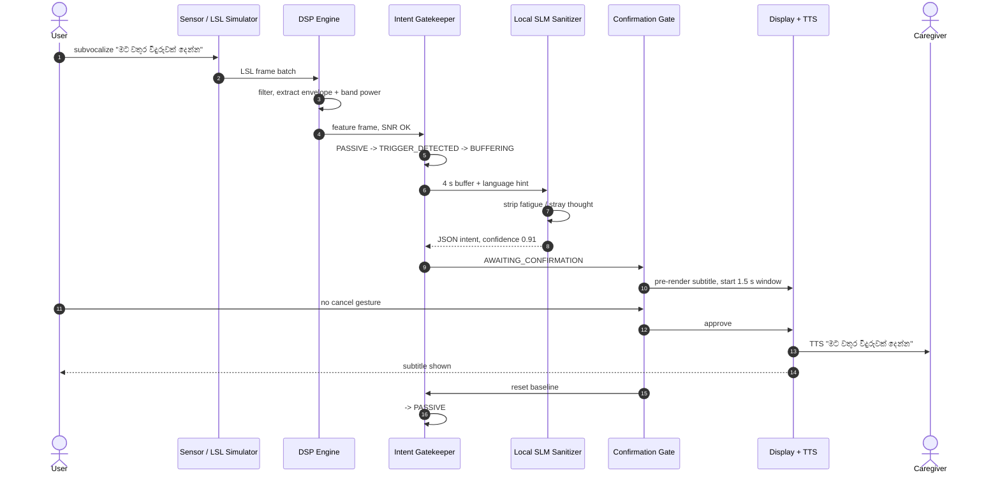
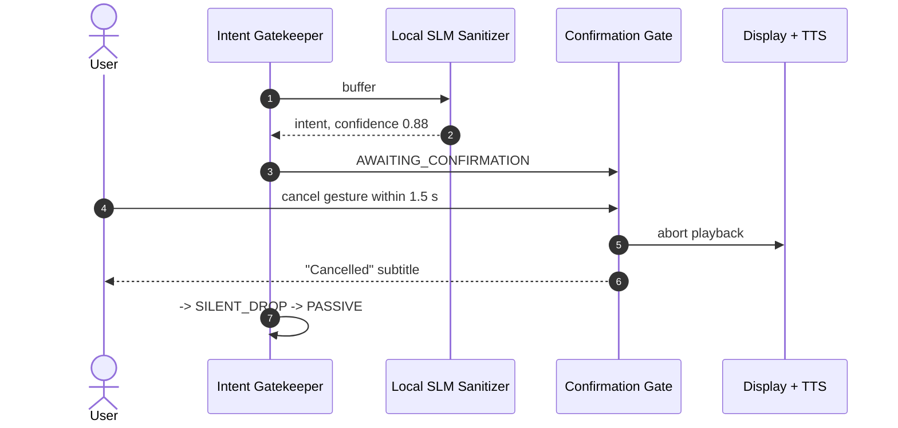

# 06 — User Scenarios

## Scenario A — "Please bring me a glass of water" (happy path)

A non-verbal user at home is wearing an sEMG/EEG headband. They are tired, and
their resting inner monologue is noisy.

Source: [`diagrams/06-sequence-happy-path.mmd`](diagrams/06-sequence-happy-path.mmd)

### What the user actually produced versus what was said

| Stage | Content |
|-------|---------|
| Raw inner stream | "මට මහන්සියි වගේ... මට වතුර වීදුරුවක් දෙන්න... මගේ ඔළුව රිදෙනවා..." |
| Rejected as noise | "මට මහන්සියි වගේ" (fatigue), "මගේ ඔළුව රිදෙනවා" (pain — non-actionable here) |
| Sanitized intent | "මට වතුර වීදුරුවක් දෙන්න" |
| Delivered | subtitle + local TTS in `si-LK` |

The point of the demo is that the *noise never reaches the caregiver*. That is
the product.

## Scenario B — User cancels

The staged subtitle appears first, audio never starts. The filter is demonstrably
reversible.

## Scenario C — Low confidence

The buffer is ambiguous, and the SLM returns `confidence = 0.41`.

- Nothing is spoken.
- The display shows *"Intent unclear — please repeat."*
- The FSM returns to `PASSIVE` with a slightly wider gate for the next attempt.
- The event is counted, not logged with content.

This is the behaviour that distinguishes the system from a naive decoder, which
would have spoken the ambiguous string.

## Scenario D — No hardware (competition demo)

This is a supported operating mode, not a workaround.

1. Operator starts the **LSL replay simulator**, which publishes an EEG stream
   (replayed PhysioNet data) and a scripted synthetic sEMG envelope.
2. A side-channel script supplies the "decoded" thought stream with a known
   ground truth.
3. The rest of the stack — DSP, FSM, SLM, confirmation, TTS — runs unchanged.
4. The demo prints the ground truth next to the delivered output so the audience
   can verify the filter worked rather than trusting a scripted result.

The claim made on stage is precise: *"Every layer except the sensor is real
software. The sensor is a replay of real open data over the real protocol. Plug
in any LSL headband and only the outlet changes."*

## Scenario E — Degraded signal

The headband shifts during the session; SNR drops below the floor.

- Frames are discarded; no intent is attempted.
- Incidents accumulate.
- If the incident count crosses the limit, the FSM enters `FAULT` and the display
  shows *"Sensor contact lost — please adjust the headband."*
- An operator must re-run calibration; the system does not auto-resume.

## Scenario F — Caregiver handoff

A caregiver joins the conversation. The user wants to say one sentence, not
broadcast their whole inner state.

| Concern | Behaviour |
|---------|-----------|
| Privacy in front of others | only confirmed utterances leave the device |
| Consent for a new listener | local UI indicator shows the output is assistive, not the user's literal thought |
| Misunderstanding | rejected fragments remain visible on the user's own screen for inspection |

## Personas

| Persona | Need | What NeuroGate gives them |
|---------|------|---------------------------|
| Non-verbal user (e.g. ALS, post-stroke) | reliable, dignified output | gated, sanitized utterances; cancellable |
| Caregiver | understandable, trustworthy output | clear subtitles, visible assistive indicator |
| Clinician / operator | reproducibility | session-scoped calibration, fault codes, no hidden state |
| Researcher | measurable behaviour | deterministic logs of gating decisions, benchmarkable |
