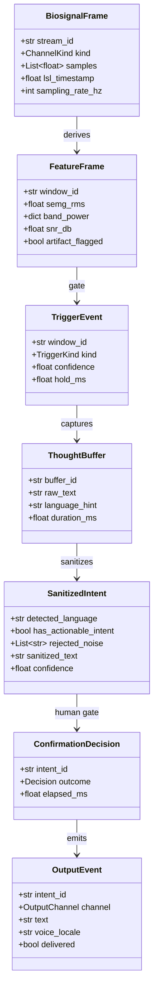

# 07 — Data Contracts

Every structure that crosses a module, process, or device boundary is a
Pydantic v2 model. Raw dictionaries do not cross boundaries. This is a
constitution-level requirement (Principle II).

## 1. Contract graph



Source: [`diagrams/09-data-contracts.mmd`](diagrams/09-data-contracts.mmd)

## 2. Enumerations

| Enum | Members | Notes |
|------|---------|-------|
| `ChannelKind` | `EEG`, `SEMG` | drives which DSP branch runs |
| `TriggerKind` | `VOLITIONAL`, `TRANSIENT`, `NONE` | `TRANSIENT` is rejected by the FSM |
| `Decision` | `APPROVED`, `CANCELLED`, `TIMEOUT`, `NO_RESPONSE` | only `APPROVED` and `TIMEOUT` may emit |
| `OutputChannel` | `SUBTITLE`, `TTS` | both may fire for one decision |
| `Language` | `SI`, `TA`, `EN`, `UNKNOWN` | maps to locale, never inferred twice |
| `FaultClass` | `LOW_SNR`, `SLM_TIMEOUT`, `SCHEMA_INVALID`, `TTS_UNAVAILABLE`, `REPEATED_FAULT` | stable codes for logging |

## 3. Field constraints

| Model | Field | Constraint | Reason |
|-------|-------|------------|--------|
| `BiosignalFrame` | `samples` | non-empty, length ≤ 1 s at declared rate | bounds memory |
| `BiosignalFrame` | `sampling_rate_hz` | 100–2000 | rejects misconfigured devices |
| `FeatureFrame` | `semg_rms` | 0.0–1.0 | normalized by calibration |
| `FeatureFrame` | `snr_db` | −20–60 | physical plausibility |
| `ThoughtBuffer` | `raw_text` | 1–2000 chars | hard cap before the SLM |
| `ThoughtBuffer` | `duration_ms` | 0–5000 | matches ring buffer |
| `SanitizedIntent` | `confidence` | 0.0–1.0 | drives the confidence floor |
| `SanitizedIntent` | `sanitized_text` | ≤ 500 chars | bounds output |
| `ConfirmationDecision` | `elapsed_ms` | 0–5000 | auditability |
| `OutputEvent` | `voice_locale` | must be a locale valid for `detected_language` | prevents silent language swaps |

## 4. SanitizedIntent — the SLM's only permitted output

```json
{
  "detected_language": "si-LK",
  "has_actionable_intent": true,
  "rejected_noise": ["මට මහන්සියි"],
  "sanitized_text": "මට වතුර වීදුරුවක් දෙන්න",
  "confidence": 0.91
}
```

Validation rules applied after the model responds:

1. The response MUST parse as JSON with no surrounding prose.
2. `detected_language` MUST be in the `Language` enum.
3. `sanitized_text` MUST be non-empty when `has_actionable_intent` is true.
4. `sanitized_text` MUST NOT appear in `rejected_noise` (contradiction check).
5. `confidence` MUST be present and within range.

Any failure → `SCHEMA_INVALID` fault → `SILENT_DROP`. The raw model output is
never passed through.

## 5. Invariants

| Invariant | Enforced by |
|-----------|-------------|
| No `OutputEvent` without a `ConfirmationDecision` | FSM transition table |
| No `SanitizedIntent` exists outside `SANITIZING`/`AWAITING_CONFIRMATION` | session-scoped object graph |
| `window_id` is monotonic per session | ingest counter |
| No model crosses a process boundary unless it is a Pydantic instance | boundary rule |
| `sanitized_text` never originates from `raw_text` verbatim without model output | provenance check in validator |
| Nothing is persisted | no serializer writes to disk |

## 6. Versioning

Contract changes are breaking changes. A change to a field name, type, or
constraint requires:

1. a spec update,
2. a migration note in this document,
3. a test that fails against the old contract.

This applies even in the prototype phase, because these models are the only
stable interface between the tiers.
