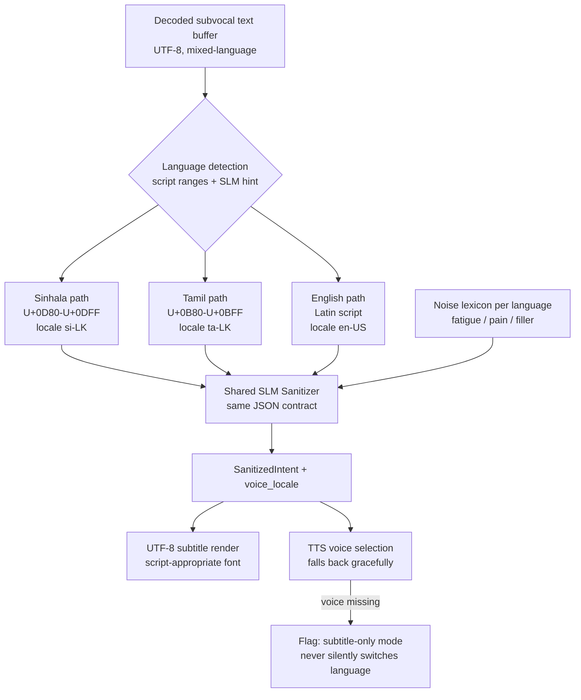

# 08 — Multilingual Support (Sinhala / Tamil / English)

Multilingual support is a first-class requirement, not a translation afterthought.
The competition awards bonus marks for Sinhala and Tamil support, but the deeper
reason is that a communication aid that only works in English is not a
communication aid in Sri Lanka.

## 1. Routing

Source: [`diagrams/10-multilingual-routing.mmd`](diagrams/10-multilingual-routing.mmd)

## 2. What is and is not language-dependent

| Layer | Language-dependent? | Why |
|-------|--------------------|-----|
| Ingest (LSL) | no | raw samples carry no script |
| DSP / feature extraction | no | physics is language-agnostic |
| FSM transitions | **no** | transitions key off booleans and thresholds, never strings |
| SLM sanitization | yes | lexicon, syntax, filler differ per language |
| Subtitle rendering | yes | script shaping, fonts, line breaking |
| TTS | yes | voice selection and locale |

The deliberate design choice: **the state machine never contains language
strings.** A Sinhala utterance and an English utterance traverse exactly the same
states. This keeps the gate auditable and prevents locale-specific logic from
becoming a source of false activations.

## 3. Detection strategy

Detection runs in two passes, cheapest first:

1. **Script-range check.** Sinhala `U+0D80–U+0DFF`, Tamil `U+0B80–U+0BFF`.
   Deterministic, instant, handles the common case.
2. **SLM hint.** For code-mixed buffers (very common in Sri Lankan speech — e.g.
   Sinhala sentence-final particles inside an English sentence), the SLM returns
   its own `detected_language` guess.

Conflict resolution:

| Situation | Resolution |
|-----------|------------|
| Script check is unambiguous | trust the script check |
| Script check is mixed | trust the SLM hint, keep both scripts in the subtitle |
| Ties | default to the user's configured primary language, and mark the intent `UNKNOWN` if confidence < floor |

`UNKNOWN` never reaches TTS with a guessed locale. It renders as text only.

## 4. Per-language noise lexicons

The SLM is instructed with explicit, curated negative examples rather than
relying on the model's latent knowledge.

| Language | Noise examples (filtered) | Intent examples (kept) |
|----------|--------------------------|------------------------|
| Sinhala | මට මහන්සියි (I'm tired), මගේ ඔළුව රිදෙනවා (my head hurts), ඒක නෙමෙයි (not that) | මට වතුර වීදුරුවක් දෙන්න (give me a glass of water) |
| Tamil | எனக்கு களைப்பாக இருக்கிறது (I feel tired), தலை வலிக்கிறது (my head hurts) | எனக்கு ஒரு டம்ளர் தண்ணீர் தாருங்கள் (give me a glass of water) |
| English | "I'm so exhausted", "my back hurts" | "please bring me a glass of water" |

These lexicons are configuration data, so a clinician or speech therapist can
extend them per user without touching code.

## 5. Rendering requirements

| Requirement | Detail |
|-------------|--------|
| Encoding | UTF-8 end to end; no latin-1 transcode anywhere |
| Fonts | fallback chain that includes Sinhala and Tamil glyph coverage |
| Line breaking | Sinhala and Tamil do not break like Latin; use script-aware wrapping |
| Combining marks | test at large sizes; Tamil vowel signs are easy to clip |
| Contrast | validate at WCAG AA against the actual font, not generic Latin text |
| Mixed scripts | render in one line where possible; never reorder RTL-adjacent content (not applicable here, but the rule is stated for future scripts) |

## 6. TTS

| Language | Locale | Fallback if voice missing |
|----------|--------|---------------------------|
| Sinhala | `si-LK` | subtitle-only, visible banner |
| Tamil | `ta-LK` (then `ta-IN`) | subtitle-only, visible banner |
| English | `en-US` (then `en-GB`) | subtitle-only, visible banner |

The system **never** silently falls back to a different language's voice. Speaking
Sinhala text with an English phoneme set produces unintelligible output, which is
worse than no audio at all.

## 7. Open problems

- **Code-mixed utterances.** Real Sri Lankan speech mixes languages mid-sentence.
  Detection is the weakest link; the benchmark must include code-mixed cases.
- **SLM quality for Sinhala/Tamil.** 3B-parameter models are weaker in these
  languages than in English. The sanitizer may need a smaller dedicated classifier
  in front, with the SLM used only for extraction.
- **TTS coverage.** OS voice availability varies by platform and installation.
  The product must treat subtitles as the guaranteed channel and audio as an
  enhancement.
