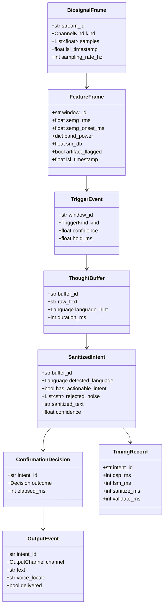
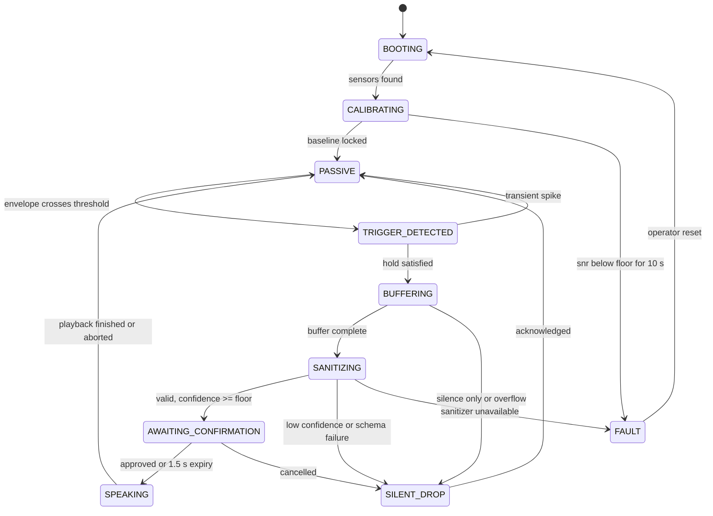

# Phase 1 Data Model — NeuroGate

All types are Pydantic v2 models in `src/neurogate/contracts/`. Raw dictionaries do
not cross module boundaries (constitution Principle II). Every entity is transient:
none is serialized to durable storage at any point.

**Lifetime legend**

| Lifetime | Meaning |
|----------|---------|
| `frame` | exists only inside one processing step |
| `cycle` | created when an intent cycle starts, destroyed when it ends (≤ ~6 s) |
| `session` | lives as long as the device session; holds no content, only thresholds |
| `process` | immutable configuration loaded at start |

---

## Entity overview

---

## 1. BiosignalFrame

| Field | Type | Constraint | Lifetime |
|-------|------|-----------|----------|
| `stream_id` | `str` | 1–64 chars, non-empty | `frame` |
| `kind` | `ChannelKind` | `EEG` \| `SEMG` | `frame` |
| `samples` | `list[float]` | 1–1000 elements; finite; no NaN/Inf | `frame` |
| `lsl_timestamp` | `float` | ≥ 0, monotonic per stream | `frame` |
| `sampling_rate_hz` | `int` | 100–2000 | `frame` |

**Validation rules**

- `len(samples) <= sampling_rate_hz` (never more than one second per frame).
- All samples finite; NaN/Inf rejected at the edge, before any filter runs.
- `lsl_timestamp` strictly increasing per `stream_id`; out-of-order frames are
  dropped with a counter increment, not reordered.

---

## 2. FeatureFrame

| Field | Type | Constraint | Lifetime |
|-------|------|-----------|----------|
| `window_id` | `str` | monotonic per session | `frame` |
| `semg_rms` | `float` | 0.0–1.0 (normalized by calibration) | `frame` |
| `semg_onset_ms` | `float` | 0–5000 | `frame` |
| `band_power` | `dict[Band, float]` | keys ⊆ {delta, theta, alpha, beta}; ≥ 0 | `frame` |
| `snr_db` | `float` | −20 to 60 | `frame` |
| `artifact_flagged` | `bool` | — | `frame` |
| `lsl_timestamp` | `float` | ≥ 0 | `frame` |

**Validation rules**

- `semg_rms` outside [0,1] means calibration was not applied → reject frame.
- `snr_db` below the session floor is a quality rejection, not a model error.
- `artifact_flagged = true` forces the FSM to treat the frame as `TRANSIENT`.

---

## 3. TriggerEvent

| Field | Type | Constraint | Lifetime |
|-------|------|-----------|----------|
| `window_id` | `str` | references a FeatureFrame | `cycle` |
| `kind` | `TriggerKind` | `VOLITIONAL` \| `TRANSIENT` \| `NONE` | `cycle` |
| `confidence` | `float` | 0.0–1.0 | `cycle` |
| `hold_ms` | `float` | 0–2000 | `cycle` |

**Invariant**: `kind = VOLITIONAL` requires `hold_ms >= configured hold floor` and
`artifact_flagged = false` on the source frame. The FSM asserts this; a violation is
a programming error, not a runtime condition.

---

## 4. ThoughtBuffer

| Field | Type | Constraint | Lifetime |
|-------|------|-----------|----------|
| `buffer_id` | `str` | unique per cycle | `cycle` |
| `raw_text` | `str` | 1–2000 chars, UTF-8 | `cycle` |
| `language_hint` | `Language` | `SI` \| `TA` \| `EN` \| `UNKNOWN` | `cycle` |
| `duration_ms` | `int` | 0–5000 | `cycle` |

**Validation rules**

- `raw_text` is capped before it reaches the model — this is a prompt-injection and
  memory bound, not a formatting preference.
- Content is destroyed no later than the end of the cycle that created it.

---

## 5. SanitizedIntent

| Field | Type | Constraint | Lifetime |
|-------|------|-----------|----------|
| `buffer_id` | `str` | references a ThoughtBuffer | `cycle` |
| `detected_language` | `Language` | must resolve to a supported value | `cycle` |
| `has_actionable_intent` | `bool` | — | `cycle` |
| `rejected_noise` | `list[str]` | 0–20 items, each ≤ 200 chars | `cycle` |
| `sanitized_text` | `str` | 0–500 chars; required when actionable | `cycle` |
| `confidence` | `float` | 0.0–1.0, composite per [research R3.1](./research.md#r31-confidence-calibration-resolves-the-specs-undefined-confidence) | `cycle` |

**Validation rules** (all must hold or the intent is discarded)

1. `has_actionable_intent = true` → `sanitized_text` non-empty.
2. `has_actionable_intent = false` → `sanitized_text` empty and no output is emitted.
3. `sanitized_text` must not appear verbatim in `rejected_noise` (contradiction).
4. `detected_language = UNKNOWN` → permitted, but `voice_locale` must be absent.
5. Script of `sanitized_text` must be compatible with `detected_language`.
6. `confidence < 0.75` → routed to `SILENT_DROP`, never to confirmation.

---

## 6. ConfirmationDecision

| Field | Type | Constraint | Lifetime |
|-------|------|-----------|----------|
| `intent_id` | `str` | references a SanitizedIntent | `cycle` |
| `outcome` | `Decision` | `APPROVED` \| `TIMEOUT` \| `CANCELLED` \| `NO_RESPONSE` | `cycle` |
| `elapsed_ms` | `int` | 0–5000 | `cycle` |

**Invariant**: only `APPROVED` and `TIMEOUT` may be followed by an `OutputEvent`
with audio. `CANCELLED` and `NO_RESPONSE` resolve to `SILENT_DROP`. Per the
clarified spec, `TIMEOUT` **is** an approval; `NO_RESPONSE` is retained only for
fault paths where the window could not be presented.

---

## 7. OutputEvent

| Field | Type | Constraint | Lifetime |
|-------|------|-----------|----------|
| `intent_id` | `str` | references a ConfirmationDecision | `cycle` |
| `channel` | `OutputChannel` | `SUBTITLE` \| `TTS` | `cycle` |
| `text` | `str` | ≤ 500 chars, UTF-8 | `cycle` |
| `voice_locale` | `str \| None` | `si-LK` \| `ta-LK` \| `ta-IN` \| `en-US` \| `en-GB`; `None` for subtitle-only | `cycle` |
| `delivered` | `bool` | true only after the backend acknowledged | `cycle` |

**Validation rules**

- A `TTS` event with `voice_locale = None` is invalid — degrade by changing
  `channel` to `SUBTITLE` instead.
- `voice_locale` must be compatible with the session-primary language.

---

## 8. TimingRecord

| Field | Type | Constraint | Lifetime |
|-------|------|-----------|----------|
| `intent_id` | `str` | — | `cycle` |
| `dsp_ms` | `int` | ≥ 0 | `cycle` |
| `fsm_ms` | `int` | ≥ 0 | `cycle` |
| `sanitize_ms` | `int` | ≥ 0 | `cycle` |
| `validate_ms` | `int` | ≥ 0 | `cycle` |

Emitted to the event stream as counts only. Never carries text.

---

## 9. SessionConfig (process-lifetime, content-free)

| Field | Type | Constraint |
|-------|------|-----------|
| `primary_language` | `Language` | `SI` \| `TA` \| `EN`, set at session start |
| `operator_id` | `str` | required; recorded consent holder |
| `consent_recorded` | `bool` | must be `true` before capture starts |
| `semg_threshold` | `float` | derived by calibration |
| `hold_floor_ms` | `int` | 150–500 |
| `snr_floor_db` | `float` | derived by calibration |
| `confidence_floor` | `float` | default 0.75 |
| `confirmation_window_ms` | `int` | default 1500 |
| `tts_backend` | `str` | `webspeech` \| `espeak` \| `none`, chosen once |

**Note**: This is the only entity that outlives a cycle. It carries no biosignal and
no thought content. See [ADR 0002](../../docs/adr/0002-ephemeral-state.md).

---

## State machine

`fsm/machine.py` implements the transition table. States and events are enums; the
table is exhaustive, and every illegal pair raises rather than passing through.

**Transition invariants** (property-tested with `hypothesis`)

1. No path reaches `SPEAKING` without passing `AWAITING_CONFIRMATION`.
2. `FAULT` has no outgoing event transition except operator reset.
3. Every state has a timeout; expiry never yields `SPEAKING` except from
   `AWAITING_CONFIRMATION`.
4. `CALIBRATING → PASSIVE` requires `consent_recorded = true` and a locked baseline.

---

## Relationship summary

| From | To | Cardinality | Rule |
|------|----|-------------|------|
| BiosignalFrame | FeatureFrame | many → one | a window aggregates many frames |
| FeatureFrame | TriggerEvent | one → zero or one | only accepted frames yield an event |
| TriggerEvent | ThoughtBuffer | one → one | a volitional trigger opens exactly one buffer |
| ThoughtBuffer | SanitizedIntent | one → zero or one | sanitizer failure yields none |
| SanitizedIntent | ConfirmationDecision | one → one | every staged intent is resolved, never left pending |
| ConfirmationDecision | OutputEvent | one → zero or more | `SUBTITLE` and `TTS` are separate events |
| SanitizedIntent | TimingRecord | one → one | per-cycle telemetry |

## Content-retention matrix

| Entity | Contains thought content? | Disk | Cross-cycle |
|--------|--------------------------|------|-------------|
| BiosignalFrame | biosignal only | never | no |
| FeatureFrame | no | never | no |
| TriggerEvent | no | never | no |
| ThoughtBuffer | **yes** | never | no |
| SanitizedIntent | **yes** | never | no |
| ConfirmationDecision | no | never | no |
| OutputEvent | **yes** | never | no |
| TimingRecord | no | never | no |
| SessionConfig | no | config file only, no content | yes (session lifetime) |
